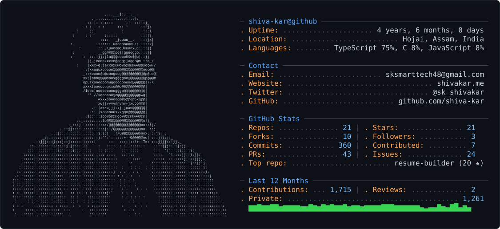
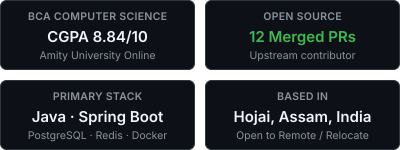
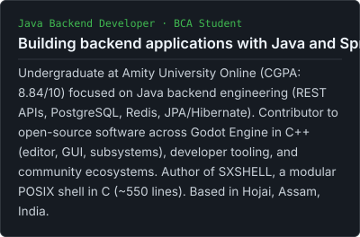
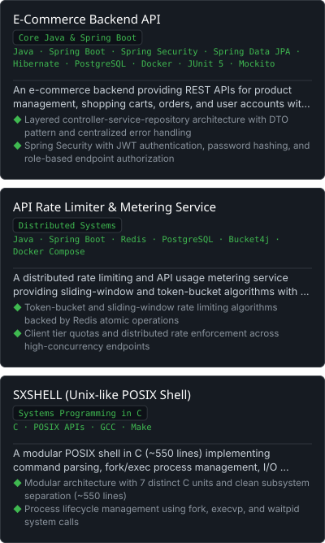
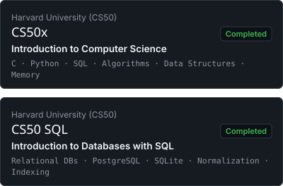
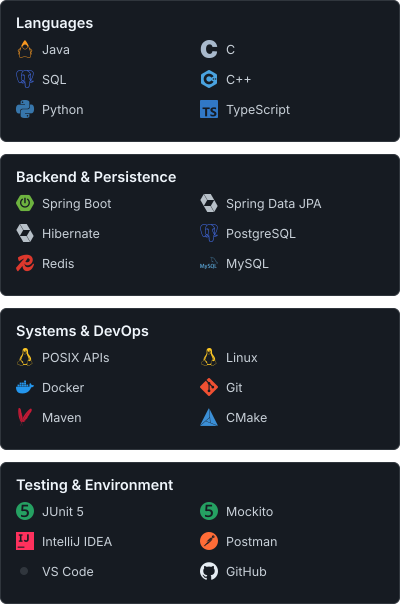
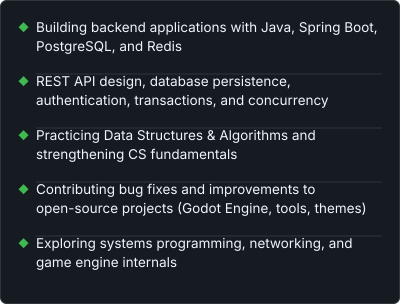
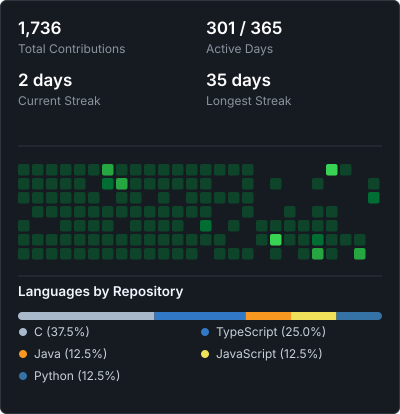
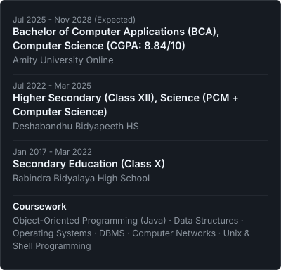

<!-- Generated by scripts/render-svgs.py from data/profile.json. Edit scripts/config.py to update info. -->

<picture>
  <source media="(prefers-color-scheme: dark)" srcset="assets/svg/banner-dark.svg" />
  <source media="(prefers-color-scheme: light)" srcset="assets/svg/banner-light.svg" />
  
</picture>

<picture><source media="(prefers-color-scheme: light) and (min-width: 1012px)" srcset="assets/svg/pills-light.svg" /><source media="(prefers-color-scheme: dark) and (min-width: 1012px)" srcset="assets/svg/pills-dark.svg" /><source media="(prefers-color-scheme: light)" srcset="assets/svg/pills-light-mobile.svg" /><source media="(prefers-color-scheme: dark)" srcset="assets/svg/pills-dark-mobile.svg" /></picture>

<picture><source media="(prefers-color-scheme: light) and (min-width: 1012px)" srcset="assets/svg/about-light.svg" /><source media="(prefers-color-scheme: dark) and (min-width: 1012px)" srcset="assets/svg/about-dark.svg" /><source media="(prefers-color-scheme: light)" srcset="assets/svg/about-light-mobile.svg" /><source media="(prefers-color-scheme: dark)" srcset="assets/svg/about-dark-mobile.svg" /></picture>

<a href="https://www.linkedin.com/in/shiva-kar/"><picture><source media="(prefers-color-scheme: light)" srcset="assets/svg/connect-linkedin-light.svg" /><source media="(prefers-color-scheme: dark)" srcset="assets/svg/connect-linkedin-dark.svg" /></picture></a>
<a href="mailto:sksmarttech48@gmail.com"><picture><source media="(prefers-color-scheme: light)" srcset="assets/svg/connect-email-light.svg" /><source media="(prefers-color-scheme: dark)" srcset="assets/svg/connect-email-dark.svg" /></picture></a>
<a href="https://shivakar.me"><picture><source media="(prefers-color-scheme: light)" srcset="assets/svg/connect-portfolio-light.svg" /><source media="(prefers-color-scheme: dark)" srcset="assets/svg/connect-portfolio-dark.svg" /></picture></a>
<a href="https://github.com/shiva-kar"><picture><source media="(prefers-color-scheme: light)" srcset="assets/svg/connect-github-light.svg" /><source media="(prefers-color-scheme: dark)" srcset="assets/svg/connect-github-dark.svg" /></picture></a>
<a href="https://x.com/sk_shivakar"><picture><source media="(prefers-color-scheme: light)" srcset="assets/svg/connect-x-light.svg" /><source media="(prefers-color-scheme: dark)" srcset="assets/svg/connect-x-dark.svg" /></picture></a>

<picture><source media="(prefers-color-scheme: light) and (min-width: 1012px)" srcset="assets/svg/header-projects-light.svg" /><source media="(prefers-color-scheme: dark) and (min-width: 1012px)" srcset="assets/svg/header-projects-dark.svg" /><source media="(prefers-color-scheme: light)" srcset="assets/svg/header-projects-light-mobile.svg" /><source media="(prefers-color-scheme: dark)" srcset="assets/svg/header-projects-dark-mobile.svg" /></picture>

<a href="https://github.com/shiva-kar?tab=repositories"><picture><source media="(prefers-color-scheme: light) and (min-width: 1012px)" srcset="assets/svg/projects-light.svg" /><source media="(prefers-color-scheme: dark) and (min-width: 1012px)" srcset="assets/svg/projects-dark.svg" /><source media="(prefers-color-scheme: light)" srcset="assets/svg/projects-light-mobile.svg" /><source media="(prefers-color-scheme: dark)" srcset="assets/svg/projects-dark-mobile.svg" /></picture></a>

<picture><source media="(prefers-color-scheme: light) and (min-width: 1012px)" srcset="assets/svg/header-opensource-light.svg" /><source media="(prefers-color-scheme: dark) and (min-width: 1012px)" srcset="assets/svg/header-opensource-dark.svg" /><source media="(prefers-color-scheme: light)" srcset="assets/svg/header-opensource-light-mobile.svg" /><source media="(prefers-color-scheme: dark)" srcset="assets/svg/header-opensource-dark-mobile.svg" /></picture>

<a href="https://github.com/search?q=is%3Apr+author%3Ashiva-kar+is%3Amerged+-user%3Ashiva-kar&amp;type=pullrequests"><picture><source media="(prefers-color-scheme: light) and (min-width: 1012px)" srcset="assets/svg/oss-light.svg" /><source media="(prefers-color-scheme: dark) and (min-width: 1012px)" srcset="assets/svg/oss-dark.svg" /><source media="(prefers-color-scheme: light)" srcset="assets/svg/oss-light-mobile.svg" /><source media="(prefers-color-scheme: dark)" srcset="assets/svg/oss-dark-mobile.svg" /></picture></a>

<picture><source media="(prefers-color-scheme: light) and (min-width: 1012px)" srcset="assets/svg/header-certs-light.svg" /><source media="(prefers-color-scheme: dark) and (min-width: 1012px)" srcset="assets/svg/header-certs-dark.svg" /><source media="(prefers-color-scheme: light)" srcset="assets/svg/header-certs-light-mobile.svg" /><source media="(prefers-color-scheme: dark)" srcset="assets/svg/header-certs-dark-mobile.svg" /></picture>

<picture><source media="(prefers-color-scheme: light) and (min-width: 1012px)" srcset="assets/svg/certs-light.svg" /><source media="(prefers-color-scheme: dark) and (min-width: 1012px)" srcset="assets/svg/certs-dark.svg" /><source media="(prefers-color-scheme: light)" srcset="assets/svg/certs-light-mobile.svg" /><source media="(prefers-color-scheme: dark)" srcset="assets/svg/certs-dark-mobile.svg" /></picture>

<picture><source media="(prefers-color-scheme: light) and (min-width: 1012px)" srcset="assets/svg/header-stack-light.svg" /><source media="(prefers-color-scheme: dark) and (min-width: 1012px)" srcset="assets/svg/header-stack-dark.svg" /><source media="(prefers-color-scheme: light)" srcset="assets/svg/header-stack-light-mobile.svg" /><source media="(prefers-color-scheme: dark)" srcset="assets/svg/header-stack-dark-mobile.svg" /></picture>

<picture><source media="(prefers-color-scheme: light) and (min-width: 1012px)" srcset="assets/svg/marquee-light.svg" /><source media="(prefers-color-scheme: dark) and (min-width: 1012px)" srcset="assets/svg/marquee-dark.svg" /><source media="(prefers-color-scheme: light)" srcset="assets/svg/marquee-light-mobile.svg" /><source media="(prefers-color-scheme: dark)" srcset="assets/svg/marquee-dark-mobile.svg" /></picture>

<picture><source media="(prefers-color-scheme: light) and (min-width: 1012px)" srcset="assets/svg/header-currently-light.svg" /><source media="(prefers-color-scheme: dark) and (min-width: 1012px)" srcset="assets/svg/header-currently-dark.svg" /><source media="(prefers-color-scheme: light)" srcset="assets/svg/header-currently-light-mobile.svg" /><source media="(prefers-color-scheme: dark)" srcset="assets/svg/header-currently-dark-mobile.svg" /></picture>

<picture><source media="(prefers-color-scheme: light) and (min-width: 1012px)" srcset="assets/svg/currently-light.svg" /><source media="(prefers-color-scheme: dark) and (min-width: 1012px)" srcset="assets/svg/currently-dark.svg" /><source media="(prefers-color-scheme: light)" srcset="assets/svg/currently-light-mobile.svg" /><source media="(prefers-color-scheme: dark)" srcset="assets/svg/currently-dark-mobile.svg" /></picture>

<picture><source media="(prefers-color-scheme: light) and (min-width: 1012px)" srcset="assets/svg/header-stats-light.svg" /><source media="(prefers-color-scheme: dark) and (min-width: 1012px)" srcset="assets/svg/header-stats-dark.svg" /><source media="(prefers-color-scheme: light)" srcset="assets/svg/header-stats-light-mobile.svg" /><source media="(prefers-color-scheme: dark)" srcset="assets/svg/header-stats-dark-mobile.svg" /></picture>

<a href="https://github.com/shiva-kar"><picture><source media="(prefers-color-scheme: light) and (min-width: 1012px)" srcset="assets/svg/stats-light.svg" /><source media="(prefers-color-scheme: dark) and (min-width: 1012px)" srcset="assets/svg/stats-dark.svg" /><source media="(prefers-color-scheme: light)" srcset="assets/svg/stats-light-mobile.svg" /><source media="(prefers-color-scheme: dark)" srcset="assets/svg/stats-dark-mobile.svg" /></picture></a>

<picture>
  <source media="(prefers-color-scheme: dark)" srcset="https://raw.githubusercontent.com/shiva-kar/shiva-kar/output/github-snake-dark.svg" />
  <source media="(prefers-color-scheme: light)" srcset="https://raw.githubusercontent.com/shiva-kar/shiva-kar/output/github-snake.svg" />
  
</picture>

<picture><source media="(prefers-color-scheme: light) and (min-width: 1012px)" srcset="assets/svg/header-education-light.svg" /><source media="(prefers-color-scheme: dark) and (min-width: 1012px)" srcset="assets/svg/header-education-dark.svg" /><source media="(prefers-color-scheme: light)" srcset="assets/svg/header-education-light-mobile.svg" /><source media="(prefers-color-scheme: dark)" srcset="assets/svg/header-education-dark-mobile.svg" /></picture>

<picture><source media="(prefers-color-scheme: light) and (min-width: 1012px)" srcset="assets/svg/education-light.svg" /><source media="(prefers-color-scheme: dark) and (min-width: 1012px)" srcset="assets/svg/education-dark.svg" /><source media="(prefers-color-scheme: light)" srcset="assets/svg/education-light-mobile.svg" /><source media="(prefers-color-scheme: dark)" srcset="assets/svg/education-dark-mobile.svg" /></picture>

<a href="https://shivakar.me"><picture><source media="(prefers-color-scheme: light) and (min-width: 1012px)" srcset="assets/svg/footer-light.svg" /><source media="(prefers-color-scheme: dark) and (min-width: 1012px)" srcset="assets/svg/footer-dark.svg" /><source media="(prefers-color-scheme: light)" srcset="assets/svg/footer-light-mobile.svg" /><source media="(prefers-color-scheme: dark)" srcset="assets/svg/footer-dark-mobile.svg" /></picture></a>

Stats refreshed 2026-11-23.

