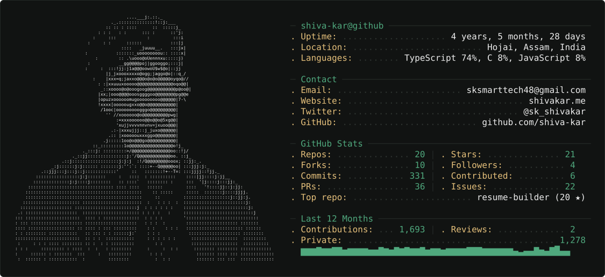
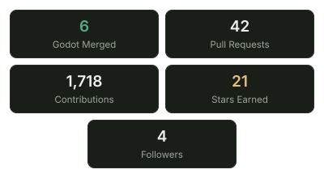
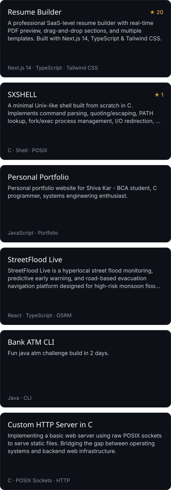
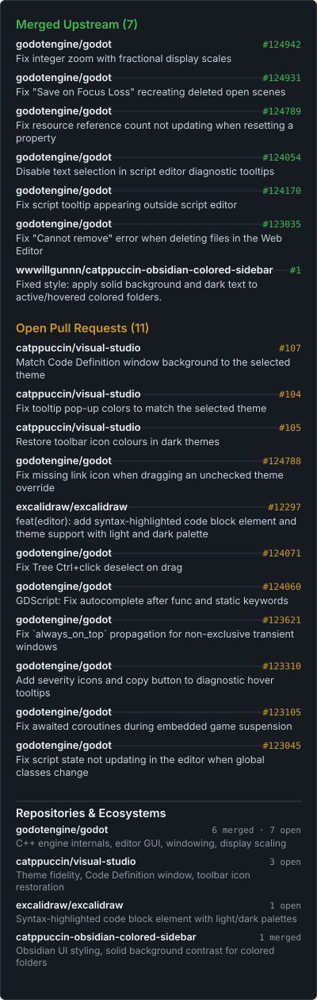
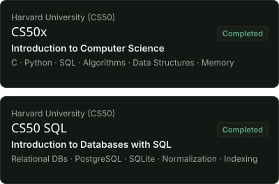
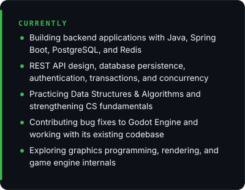
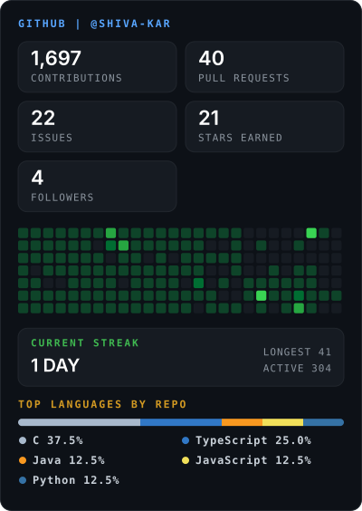
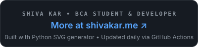

<!-- Generated by scripts/render-svgs.py from data/profile.json. Edit scripts/config.py to update info. -->

<picture>
  <source media="(prefers-color-scheme: dark)" srcset="dark_mode.svg" />
  <source media="(prefers-color-scheme: light)" srcset="light_mode.svg" />
  
</picture>

<picture><source media="(min-width: 1012px)" srcset="assets/svg/pills.svg" /></picture>

<picture><source media="(min-width: 1012px)" srcset="assets/svg/about.svg" /></picture>

<a href="https://www.linkedin.com/in/shiva-kar/"><picture></picture></a>
<a href="mailto:sksmarttech48@gmail.com"><picture></picture></a>
<a href="https://shivakar.me"><picture></picture></a>
<a href="https://github.com/shiva-kar"><picture></picture></a>
<a href="https://x.com/sk_shivakar"><picture></picture></a>

<picture><source media="(prefers-color-scheme: light) and (min-width: 1012px)" srcset="assets/svg/header-projects-light.svg" /><source media="(prefers-color-scheme: dark) and (min-width: 1012px)" srcset="assets/svg/header-projects-dark.svg" /><source media="(prefers-color-scheme: light)" srcset="assets/svg/header-projects-light-mobile.svg" /><source media="(prefers-color-scheme: dark)" srcset="assets/svg/header-projects-dark-mobile.svg" /></picture>

<a href="https://github.com/shiva-kar?tab=repositories"><picture><source media="(min-width: 1012px)" srcset="assets/svg/projects.svg" /></picture></a>

<picture><source media="(prefers-color-scheme: light) and (min-width: 1012px)" srcset="assets/svg/header-opensource-light.svg" /><source media="(prefers-color-scheme: dark) and (min-width: 1012px)" srcset="assets/svg/header-opensource-dark.svg" /><source media="(prefers-color-scheme: light)" srcset="assets/svg/header-opensource-light-mobile.svg" /><source media="(prefers-color-scheme: dark)" srcset="assets/svg/header-opensource-dark-mobile.svg" /></picture>

<a href="https://github.com/search?q=is%3Apr+author%3Ashiva-kar+is%3Amerged+-user%3Ashiva-kar&amp;type=pullrequests"><picture><source media="(min-width: 1012px)" srcset="assets/svg/oss.svg" /></picture></a>

<picture><source media="(prefers-color-scheme: light) and (min-width: 1012px)" srcset="assets/svg/header-certs-light.svg" /><source media="(prefers-color-scheme: dark) and (min-width: 1012px)" srcset="assets/svg/header-certs-dark.svg" /><source media="(prefers-color-scheme: light)" srcset="assets/svg/header-certs-light-mobile.svg" /><source media="(prefers-color-scheme: dark)" srcset="assets/svg/header-certs-dark-mobile.svg" /></picture>

<picture><source media="(min-width: 1012px)" srcset="assets/svg/certs.svg" /></picture>

<picture><source media="(prefers-color-scheme: light) and (min-width: 1012px)" srcset="assets/svg/header-stack-light.svg" /><source media="(prefers-color-scheme: dark) and (min-width: 1012px)" srcset="assets/svg/header-stack-dark.svg" /><source media="(prefers-color-scheme: light)" srcset="assets/svg/header-stack-light-mobile.svg" /><source media="(prefers-color-scheme: dark)" srcset="assets/svg/header-stack-dark-mobile.svg" /></picture>

<picture><source media="(min-width: 1012px)" srcset="assets/svg/marquee.svg" /></picture>

<picture><source media="(prefers-color-scheme: light) and (min-width: 1012px)" srcset="assets/svg/header-currently-light.svg" /><source media="(prefers-color-scheme: dark) and (min-width: 1012px)" srcset="assets/svg/header-currently-dark.svg" /><source media="(prefers-color-scheme: light)" srcset="assets/svg/header-currently-light-mobile.svg" /><source media="(prefers-color-scheme: dark)" srcset="assets/svg/header-currently-dark-mobile.svg" /></picture>

<picture><source media="(min-width: 1012px)" srcset="assets/svg/currently.svg" /></picture>

<picture><source media="(prefers-color-scheme: light) and (min-width: 1012px)" srcset="assets/svg/header-stats-light.svg" /><source media="(prefers-color-scheme: dark) and (min-width: 1012px)" srcset="assets/svg/header-stats-dark.svg" /><source media="(prefers-color-scheme: light)" srcset="assets/svg/header-stats-light-mobile.svg" /><source media="(prefers-color-scheme: dark)" srcset="assets/svg/header-stats-dark-mobile.svg" /></picture>

<a href="https://github.com/shiva-kar"><picture><source media="(min-width: 1012px)" srcset="assets/svg/stats.svg" /></picture></a>

<picture><source media="(prefers-color-scheme: light) and (min-width: 1012px)" srcset="assets/svg/header-education-light.svg" /><source media="(prefers-color-scheme: dark) and (min-width: 1012px)" srcset="assets/svg/header-education-dark.svg" /><source media="(prefers-color-scheme: light)" srcset="assets/svg/header-education-light-mobile.svg" /><source media="(prefers-color-scheme: dark)" srcset="assets/svg/header-education-dark-mobile.svg" /></picture>

<picture><source media="(min-width: 1012px)" srcset="assets/svg/education.svg" /></picture>

<a href="https://shivakar.me"><picture><source media="(min-width: 1012px)" srcset="assets/svg/footer.svg" /></picture></a>

Stats refreshed 2026-11-21.

