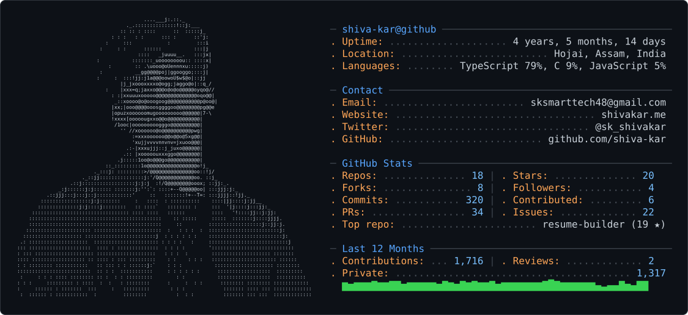

<picture>
  <source media="(prefers-color-scheme: dark)" srcset="dark_mode.svg" />
  <source media="(prefers-color-scheme: light)" srcset="light_mode.svg" />
  
</picture>

&nbsp;
&nbsp;
&nbsp;

---

## About Me

I'm **Shiva Kar**, a BCA student at **Amity University Online**.

My main focus is **Java backend development**. I work with **Java, Spring Framework & Spring Boot, Hibernate/JPA, REST APIs, PostgreSQL**, and the tools used to build backend applications and services.

I also work with **React, TypeScript and Tailwind CSS**, mainly around frontend development.

**Data Structures & Algorithms** and core computer science are also a big part of what I study and practice.

I occasionally do **C++** for contribution to open source engines like Godot.

---

## What I Work With

### Tech Stack

| Area | Technologies |
|---|---|
| **Java / Backend** | `Java` `Spring Boot` `Spring MVC` `Hibernate` `JPA` `REST APIs` `PostgreSQL` `SQL` `Redis` |
| **C / Systems** | `C` `Linux` `POSIX` `Sockets` `Networking` `Memory` `System Calls` `Graphics` |
| **Computer Science** | `Data Structures` `Algorithms` `OOP` `Operating Systems` `Computer Networks` |
| **Tools** | `Git` `GitHub` `Docker` `Linux` `Postman` `VS Code` `Kafka` |
| **Other** | `Python` `JavaScript/TypeScript` `React` `Tailwind CSS/CSS`  `HTML` |

---

## Currently

- Building backend systems with **Java and Spring Boot**
- Exploring **graphics and rendering**
- Practicing **DSA and computer science fundamentals**
- Contributing to **open source**
- Building and experimenting with different software projects

---

## GitHub Stats

---

## Education

| Degree | Institution | Duration |
|---|---|---|
| **BCA : Computer Science** | **Amity University Online** | Jul 2025 – Nov 2028 |
| **Higher Secondary (Class XII) Science (PCM + Computer Science)** | **Deshabandhu Bidyapeeth HS** | Jul 2022 – Mar 2025 |
| **Secondary Education (Class X)** | **Rabindra Bidyalaya High School** | Jan 2017 – Mar 2022 |

### Relevant Coursework

`Data Structures` `Operating Systems` `DBMS` `Computer Networks` `OOP` `Java` `Unix & Shell Programming`

---

## Certifications

- **CS50x** - Introduction to Computer Science
- **CS50 SQL** - Introduction to Databases with SQL

---

## Find Me

